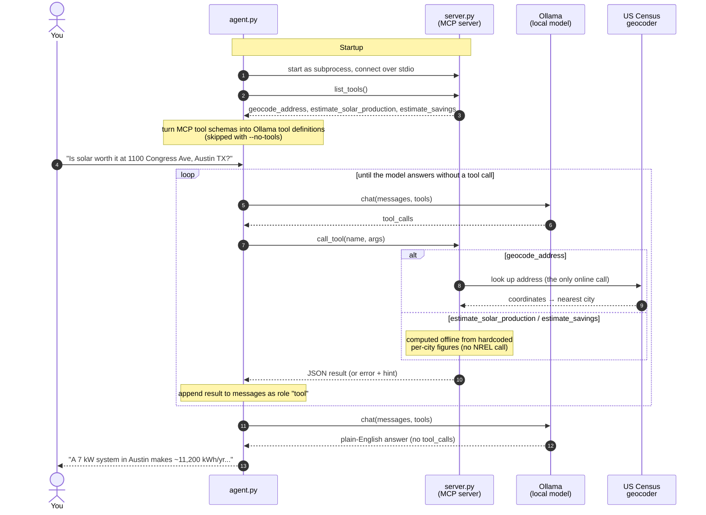

# simplelocalmcp — a local AI that can call your own code

Ask *"is solar worth it at 1100 Congress Ave, Austin TX?"* and get a real
answer from a model running on your laptop, using numbers from three small
Python functions you wrote.

Three things, nothing else:

```
 you ──► agent.py ──► Ollama (the model, on your machine)
            │
            └──MCP──► server.py (your tools: plain Python functions)
```

- **Model:** an open LLM running locally with [Ollama](https://ollama.com).
- **Tool:** a Python function with a docstring.
- **MCP:** the standard way to hand tools to *any* AI client.

## Before you come (the model download is ~4.7 GB)

```bash
brew install ollama        # or the installer from ollama.com
ollama serve &             # skip if the Ollama app is already running
ollama pull qwen2.5:7b     # slow laptop? use qwen2.5:3b and MODEL=qwen2.5:3b
```

## Run it

```bash
python3 -m venv .venv && .venv/bin/pip install -r requirements.txt
.venv/bin/python agent.py
```

```
you › Is solar worth it at 1100 Congress Ave, Austin TX 78701?
  → geocode_address({'address': '1100 Congress Ave, Austin TX 78701'})
  ← {"matched_address": "1100 CONGRESS AVE, AUSTIN, TX, 78701", "nearest_city": "Austin"}
  → estimate_solar_production({'city': 'Austin'})
  ← {"city": "Austin", "capacity_kw": 7.0, "annual_kwh": 11200}
  → estimate_savings({'annual_kwh': 11200})
  ← {"annual_savings_usd": 1680, "system_cost_usd": 19600, "payback_years": 11.7, ...}

A typical 7 kW system in Austin makes about 11,200 kWh a year, saving
roughly $1,680. At about $19,600 installed, it pays for itself in ~12 years.
```

*(Illustrative: the tool calls are real output, the final sentence is the
kind of answer to expect. Replace it with a real run.)*

You can ask with a full street address or just a city name. An address in a
suburb (Round Rock, Plano) uses the nearest city in the table.

## The demo, step by step

1. **The problem.** `python agent.py --no-tools` and ask the same question.
   The model answers confidently, with numbers it made up.
2. **Look at the tools on their own.** No AI involved, just click them:
   `npx @modelcontextprotocol/inspector .venv/bin/python server.py`
3. **Connect them.** `python agent.py`. Same model, but now every number
   comes from a tool, and you can see each call.
4. **Prove it's local.** Turn Wi-Fi off and ask about a *city* ("Austin").
   It still works. Now try an *address*: `geocode_address` fails, because it
   is the one tool that goes online. The model stays local; the only thing
   sent out is the address, to the US Census geocoder.
5. **Errors guide the model.** Ask about an address outside Texas. The tool
   returns a `hint`, and the model passes it on instead of guessing.
6. **Add your own tool.** Paste this into `server.py`, restart the agent, and
   ask *"I have 500 sq ft of roof in Houston, what would solar save me?"*

   ```python
   @mcp.tool()
   def roof_area_to_capacity(square_feet: float) -> dict:
       """Estimate how many kW of solar panels fit on a roof of this size."""
       return {"capacity_kw": round(square_feet / 100, 1)}
   ```

## How it works



## What's in each file

| File | Lines | What it shows |
|---|---|---|
| `server.py` | ~110 | An MCP server: `@mcp.tool()` turns a function into a tool. The docstring is what the model reads. |
| `agent.py` | ~60 | The agent loop: list tools → ask the model → run the tools it picks → repeat until it answers. |

The solar figures are rough per-city averages, hardcoded so the demo needs no
API key. Address lookup uses the free US Census geocoder (no key, no signup).

## Where to go next

[`localaimcp`](https://github.com/rajeshalwar/localaimcp) is the full version: real NREL and Census data,
Postgres, systemd, and network isolation enforced by containers, so the model
*can't* reach the internet.
