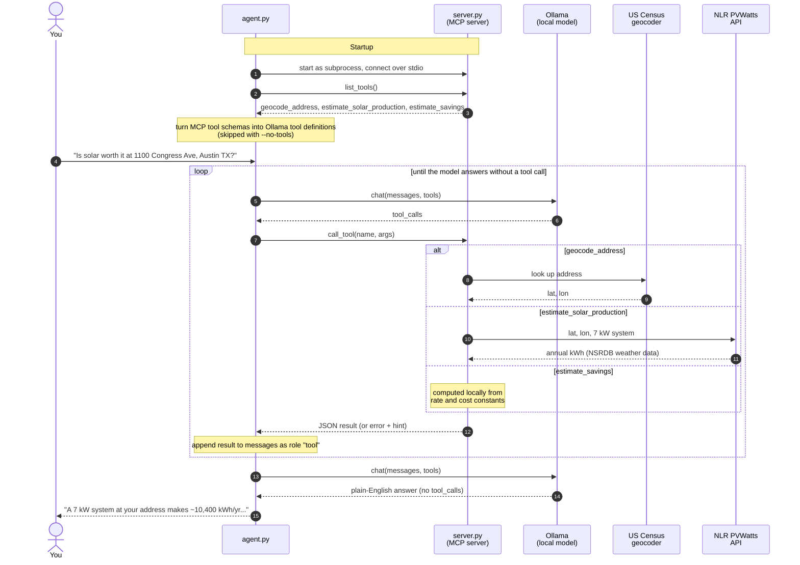

# simplelocalmcp — a local AI that can call your own code

Ask *"is solar worth it at 1100 Congress Ave, Austin TX?"* and get a real
answer from a model running on your laptop, using numbers from three small
Python functions you wrote.

Three things, nothing else:

```
 you ──► agent.py ──► Ollama (the model, on your machine)
            │
            └──MCP──► server.py (your tools: plain Python functions)
```

- **Model:** an open LLM running locally with [Ollama](https://ollama.com).
- **Tool:** a Python function with a docstring.
- **MCP:** the standard way to hand tools to *any* AI client.

## Before you come (the model download is ~4.7 GB)

```bash
brew install ollama        # or the installer from ollama.com
ollama serve &             # skip if the Ollama app is already running
ollama pull qwen2.5:7b     # slow laptop? use qwen2.5:3b and MODEL=qwen2.5:3b
```

## Run it

```bash
python3 -m venv .venv && .venv/bin/pip install -r requirements.txt
.venv/bin/python agent.py
```

Solar production comes from NLR's [PVWatts](https://developer.nlr.gov/docs/solar/pvwatts/v8/)
API. It works out of the box with the shared `DEMO_KEY`, which is heavily rate
limited. For a demo, get a free key at <https://developer.nlr.gov/signup/> and
run `NLR_API_KEY=your-key .venv/bin/python agent.py`.

```
you › Is solar worth it at 1100 Congress Ave, Austin TX 78701?
  → geocode_address({'address': '1100 Congress Ave, Austin TX 78701'})
  ← {"matched_address": "1100 CONGRESS AVE, AUSTIN, TX, 78701", "lat": 30.27644, "lon": -97.73975}
  → estimate_solar_production({'lat': 30.27644, 'lon': -97.73975, 'capacity_kw': 7})
  ← {"capacity_kw": 7.0, "annual_kwh": 10382, "weather_data": "NSRDB PSM V3 GOES tmy-2020 3.2.0"}
  → estimate_savings({'annual_kwh': 10382, 'capacity_kw': 7})
  ← {"annual_savings_usd": 1557, "system_cost_usd": 19600, "payback_years": 12.6, ...}

A 7 kW system at your address makes about 10,400 kWh a year, saving
roughly $1,560. At about $19,600 installed, it pays for itself in ~12.6 years.
```

*(The tool calls are real output; the final answer is shortened.)*

Ask with a full street address in Texas. The Census geocoder needs a street,
so a bare city name ("Austin") won't match.

## The demo, step by step

1. **The problem.** `python agent.py --no-tools` and ask the same question.
   The model answers confidently, with numbers it made up.
2. **Look at the tools on their own.** No AI involved, just click them:
   `npx @modelcontextprotocol/inspector .venv/bin/python server.py`
3. **Connect them.** `python agent.py`. Same model, but now every number
   comes from a tool, and you can see each call.
4. **Prove the model is local.** Turn Wi-Fi off and ask again. The model
   still runs and answers, but the tools fail and it passes on their `hint`.
   The only things sent out are the address (to the US Census geocoder) and
   its coordinates (to PVWatts). Your question and the conversation never
   leave the laptop.
5. **Errors guide the model.** Ask about an address outside Texas. The tool
   returns a `hint`, and the model passes it on instead of guessing.
6. **Add your own tool.** Paste this into `server.py`, restart the agent, and
   ask *"I have 500 sq ft of roof at 1201 Smith St, Houston TX 77002, what
   would solar save me?"*

   ```python
   @mcp.tool()
   def roof_area_to_capacity(square_feet: float) -> dict:
       """Estimate how many kW of solar panels fit on a roof of this size."""
       return {"capacity_kw": round(square_feet / 100, 1)}
   ```

## How it works



## What's in each file

| File | Lines | What it shows |
|---|---|---|
| `server.py` | ~100 | An MCP server: `@mcp.tool()` turns a function into a tool. The docstring is what the model reads. |
| `agent.py` | ~60 | The agent loop: list tools → ask the model → run the tools it picks → repeat until it answers. |

Address lookup uses the free US Census geocoder (no key, no signup). Solar
production comes from PVWatts for a typical roof-mounted system (south-facing,
20° tilt, 14% losses), so your own roof's direction and shading aren't taken
into account. Electricity rate and installed cost are flat Texas averages.

## Where to go next

[`localaimcp`](https://github.com/rajeshalwar/localaimcp) is the full version: real NREL and Census data,
Postgres, systemd, and network isolation enforced by containers, so the model
*can't* reach the internet.
